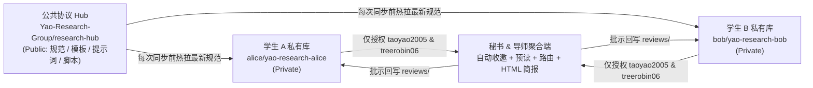

# Yao Research Group · 科研记忆与周报协议中心 (`research-hub`)

本仓库是课题组科研协作与周报系统的**公共协议中心（Public Hub）**，仅存放统一规范、提示词、标准模板、正反范例与零依赖自动化脚本，**不包含任何同学的私有研究内容、实验数据或个人记录**。

## 为什么采用「公共协议 Hub + 每人私有 Spoke」架构

1. **严格权限隔离（Day-1 生效）**：GitHub 单仓库不支持目录级读隔离。本系统采用每位同学各自独立的 **GitHub Private 仓库**（`yao-research-<pinyin>`），仅授权导师（`taoyao2005`）与会议秘书（`treerobin06`）协同读写，同学之间默认互不可见，零合入冲突。
2. **零门槛快速接入**：本协议库公开只读，所有成员（含尚未加入组织的新同学）无需等待管理员手动加权限即可在 3 分钟内由 AI 助手自动完成私有库初始化与本周周报提交。
3. **规则动态热更新**：协议要求、模板与会议时间表统一在本库迭代。学生端脚本每次同步前会核对 [`protocol/version.json`](protocol/version.json)，自动拉取最新规范，无需反复手动修改各人本地配置。
4. **“事实归 AI，判断归人”**：周报强制拆分**AI 证据页（`evidence.md`，客观陈述材料与失败记录，附来源）**与**本人判断页（`judgment.md`，本人思考与决策判断，约 300 字）**，避免会议被流水账和纯 AI 生成的长文淹没。

## 系统架构



## 每位同学私有仓库的标准结构

```text
yao-research-<pinyin>/
├── profile.md                 # 固定身份、博/硕角色、课题组结对与关联代码仓库
├── projects/                  # 按项目维护的活页卡（≤80行覆写制：PRD+最新结论+论文管线+停止条件）
│   └── <project-slug>.md
├── daily/                     # 按日无感工作日志（AI 在每次实质科研对话收尾自动追加）
│   └── YYYY-MM-DD.md
├── weekly/                    # 每周按时冻结提交的周报目录（如 2026-W48）
│   └── YYYY-Www/
│       ├── meta.yaml          # 路由元信息（会议请求、阻塞、求助对象、代码仓库）
│       ├── evidence.md        # 【AI 生成，≤2页】实验/代码/文献/失败尝试，逐条附出处
│       ├── judgment.md        # 【本人撰写，≤半页约300字】核心判断5问
│       ├── product.md         # （可选，周五 21:00 前更新）产品任务进展与可演示项
│       └── artifacts/         # （可选）轻量图表/小表，禁止上传模型权重或大数据集
└── reviews/                   # 老师 AI 预读反馈与导师批示回流（YYYY-Www-ai-review.md / advisor.md）
```

## 快速开始

- 全体同学（含 AI 自动接入与纯网页备选方案）：请直接阅读 [**ONBOARDING.md**](ONBOARDING.md)
- Agent 动态运行规范：[`protocol/agent-instructions.md`](protocol/agent-instructions.md)
- 周报标准提示词：[`protocol/prompts/`](protocol/prompts/)
- 标准模板：[`protocol/templates/`](protocol/templates/)
- 正反示例（必看）：[`examples/good-weekly-example/`](examples/good-weekly-example/) 与 [`examples/bad-weekly-example/`](examples/bad-weekly-example/)
- 自动化脚本（Python 3.9+ 标准库零依赖）：[`scripts/`](scripts/)
